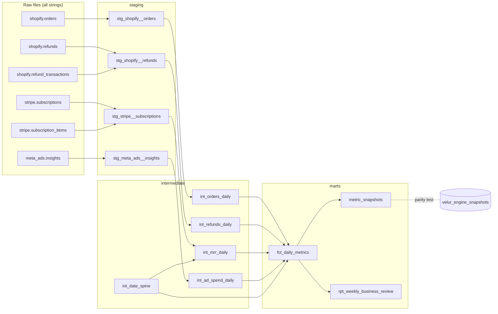

# Velur metrics in dbt

[](https://github.com/jcampos-lab/velur-metrics-dbt/actions/workflows/ci.yml)
[](https://jcampos-lab.github.io/velur-metrics-dbt/)

[Velur](https://velur.io) is a daily revenue brief for Shopify and subscription brands, live on the
[Shopify App Store](https://apps.shopify.com/velur). I built it on my own. Its metrics are computed
in TypeScript over Postgres, never by the LLM that writes the brief.

This project rebuilds those metrics in **dbt and DuckDB** from the same raw files, and the build
fails if a single number differs from what Velur's production engine computed.

| | |
|---|---|
| Metrics × days | 12 metrics × 219 days = **2,628 values** |
| Equal to Velur's production engine | **2,628 of 2,628**, exact, including every ratio's last decimal |
| Tests on every build | 72 data tests and 7 unit tests, plus the parity check |
| Raw data | 75,779 orders, 24,483 refunds, 1,946 subscriptions, 219 days of ad spend |

The parity test is not a formality. Rounding AOV down instead of half up, a one-cent change,
fails it on 110 of the 219 days.

## Lineage



Full column-level docs and the interactive lineage graph: **[dbt docs](https://jcampos-lab.github.io/velur-metrics-dbt/)**.

## The metrics

| Metric | Definition | Version |
|---|---|---|
| `gross_revenue_daily` | Line items before discounts, excluding shipping and tax, on the order's day | 1 |
| `discounts_daily` | Order discounts, on the order's day | 1 |
| `refund_amount_daily` | Refunds, on the day each refund was issued | 1 |
| `net_revenue_daily` | Gross − discounts − refunds | 1 |
| `orders_daily` | Orders placed | 1 |
| `aov_daily` | (Gross − discounts) ÷ orders, rounded half up to the cent | 1 |
| `refund_rate_daily` | Refunds issued today ÷ gross booked today | 1 |
| `new_customers_daily` | Customers whose first-ever order lands on the day | 1 |
| `repeat_customer_rate_daily` | Orders from returning known customers ÷ all orders | 2 |
| `mrr_eod` | Monthly recurring revenue at the end of the day | 2 |
| `ad_spend_daily` | Meta Ads spend, on the ad account's day | 1 |
| `blended_roas_daily` | Net revenue ÷ ad spend, from the day's own data | 1 |

Every metric carries a `calc_version`. Changing a formula bumps it, and
`assert_calc_versions_match_registry` fails the build until the SQL and the registry
(`seeds/metric_definitions.csv`) agree.

## Decisions worth reading

- **Money is integer cents.** Raw amounts are strings like `"49.00"`, parsed as `DECIMAL` and stored
  as `BIGINT` cents. A source test rejects any amount with more than two decimals, because the
  cast would round it silently.
- **A day is the store's day, not UTC.** An order at 22:30 UTC on June 1 is 00:30 on June 2 in
  Madrid, so it counts on June 2. Timestamps are converted once, in staging.
- **Refunds count on the day they are issued.** A refund for an order placed last week lowers
  today's net revenue. That is why net revenue can go negative on a quiet day.
- **Guests are revenue, never customers.** A guest checkout counts in revenue and orders but is never
  a new customer and never a returning one.
- **Trials never count toward MRR,** and a cancellation scheduled for the end of the paid period
  stops MRR at `current_period_end`, not on the day the customer asked to cancel.
- **Customer ids never leave staging.** They are replaced by `sha256(salt:id)`, the same pseudonym
  Velur uses.
- **The calendar is explicit.** `int_date_spine` makes a day with no orders a row of zeros, never a
  missing row that a chart would skip.
- **Rounding matches the production engine.** JavaScript's `Math.round` sends ties toward +∞, so
  ROAS of −0.00125 rounds to −0.0012. The `round_half_up` macro does the same.
- **Weekly ratios come from weekly sums.** `rpt_weekly_business_review` never averages daily rates,
  and it shows a week-over-week change only between two complete weeks with a positive base.

## How it is tested

1. **Source tests** check the raw files before anything is built: keys, money formats, known
   subscription statuses, monthly-only billing, one day per ad-insights row.
2. **Unit tests** (dbt 1.8+) check the hard cases with hand-derived numbers: the timezone boundary,
   guest checkouts, trials, scheduled cancellations, negative-ROAS rounding and partial weeks. Three
   of the seven reuse cases and numbers from Velur's own hand-derived golden tests.
3. **The parity test** compares all 2,628 values with Velur's engine, value and version, in both
   directions. Any row that differs, or exists on one side only, fails the build.

## Run it

```bash
python -m venv .venv && source .venv/bin/activate
pip install -r requirements.txt
dbt build                          # about 4 seconds on a laptop
dbt docs generate && dbt docs serve
```

No warehouse, keys or accounts are needed. DuckDB reads the raw files in `data/raw/` directly.

## The data

The data is synthetic. It comes from the generator behind Velur's live demo, a fictional brand
with about 300 orders a day, a paid membership and Meta Ads. It is frozen on 2026-09-30 and contains
no real customer data. `seeds/velur_engine_snapshots.csv` holds the numbers Velur's production
metric code computed from the same raw files. Velur's own code is private and is not part of this
repository.

## Layout

```
data/raw/               raw files as an extract tool would land them
models/staging/         one folder per source: types, cents, store-local days, pseudonyms
models/intermediate/    daily totals and the date spine
models/marts/           fct_daily_metrics, metric_snapshots, rpt_weekly_business_review
seeds/                  the metric registry and Velur's engine output
tests/                  parity, version registry and source-shape tests
macros/                 cents, local dates, pseudonyms, round half up
```

---

Built by [Alexander Campos](https://www.acampos.work/), analytics engineer in Barcelona.
[Velur case study](https://www.acampos.work/work/velur) · [LinkedIn](https://www.linkedin.com/in/juan-alexander-campos/)
